# 📸 CuitBox Studio — Photobox Website & Management System

<div align="center">


**Sistem Manajemen Booth Photobox & Platform Reservasi Pengunjung Berbasis Web**

[](https://codeigniter.com)
[](https://php.net)
[](https://tailwindcss.com)
[](https://mysql.com)
[](LICENSE)

*Submission for Uji Kompetensi BNSP Skema Asisten Pengembang Web (SKKNI No. 282 Th. 2016)*  
**Program Teknologi Informasi (TI-FSD) — CCIT Fakultas Teknik Universitas Indonesia**

</div>

---

## 📋 Daftar Isi
* [Tentang Proyek](#-tentang-proyek)
* [Fitur Unggulan](#-fitur-unggulan)
* [Demo & Screenshot](#-demo--screenshot)
* [Teknologi](#-teknologi)
* [Arsitektur Sistem](#-arsitektur-sistem)
* [Instalasi & Setup](#-instalasi--setup)
* [Penggunaan](#-penggunaan)
* [API Documentation](#-api-documentation)
* [Testing](#-testing)
* [Tim Pengembang](#-tim-pengembang)

---

## 📖 Tentang Proyek
**CuitBox Studio** adalah aplikasi web komprehensif yang dirancang untuk mengotomasi operasional bisnis studio *photobox* modern. Aplikasi ini membagi sistem menjadi dua subsistem terintegrasi:

1. **User Booking Portal (Sisi Pelanggan):** Memungkinkan pelanggan memilih lokasi mesin *booth*, melihat ketersediaan jadwal slot secara *real-time*, memilih paket cetak foto, memilih template bingkai (*frame*), hingga melakukan pembayaran mandiri.
2. **Admin Management Panel (Sisi Pengelola):** Menyediakan kontrol menyeluruh bagi pengelola untuk memantau status mesin booth, mengelola antrean pemotretan, mengatur hak akses staf (*Role-Based Access Control*), mengelola template frame & filter, serta memantau mutasi transaksi keuangan.

---

## 🚀 Fitur Unggulan

### 🔹 Sisi Admin Panel
- **Role-Based Access Control (RBAC):** Pemisahan hak akses berjenjang (*Super Admin*, *Admin*, dan *Staff*) untuk menjamin keamanan operasional.
- **Booth Machine Management:** Pemantauan status operasional (*Ready*, *In Use*, *Maintenance*), antrean aktif, dan koordinat mesin.
- **Real-Time Booking & Slot Calendar:** Manajemen jadwal slot reservasi berbasis kalender interaktif untuk mencegah tabrakan jadwal (*double-booking*).
- **Payment & Transaction Audit:** Validasi pembayaran pelanggan, pelacakan status transaksi, dan pencetakan faktur/invoice digital.
- **Digital Frame & Filter Management:** Pengaturan katalog template bingkai foto (*grid layout*, ukuran strip, kategori) dan filter warna.
- **Automated Cloud Backup & Notifications:** Terintegrasi dengan **Google Drive OAuth API** untuk pencadangan hasil foto dan **SMTP Gmail** untuk pengiriman bukti reservasi.

### 🔹 Sisi Pelanggan (User Booking)
- **Interactive Schedule Picker:** Pemilihan tanggal dan jam pemotretan dinamis dengan indikator ketersediaan slot.
- **Booth Locator:** Informasi lokasi fisik mesin *booth* yang siap digunakan.
- **Katalog Opsi Cetak:** Pilihan ukuran foto (*photo strip*, 4R, dsb.) dan jumlah cetak secara transparan.
- **QR / Barcode Verification:** Penerbitan kode unik pemesanan untuk proses pemindaian (*check-in*) cepat di mesin *booth*.

---

## 📸 Demo & Screenshot

Semua berkas tangkapan layar antarmuka tersimpan lengkap di dalam folder [`Dokumentasi/`](Dokumentasi/):

### 1. Panel Manajemen Admin (`Port 8080`)
| Antarmuka | Pratinjau Tampilan | Deskripsi |
| :--- | :---: | :--- |
| **Login Admin** | 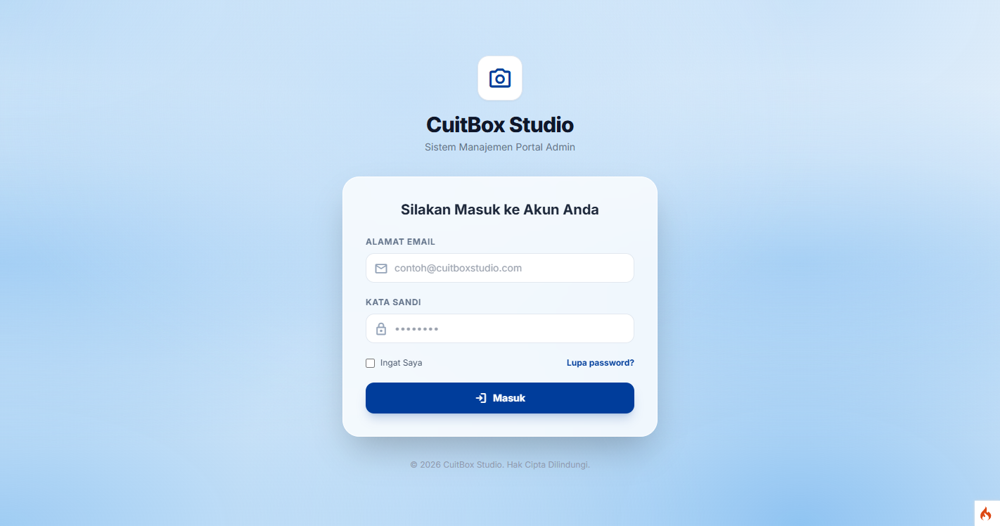 | Pintu masuk autentikasi aman bagi pengelola studio. |
| **Dashboard Utama** | 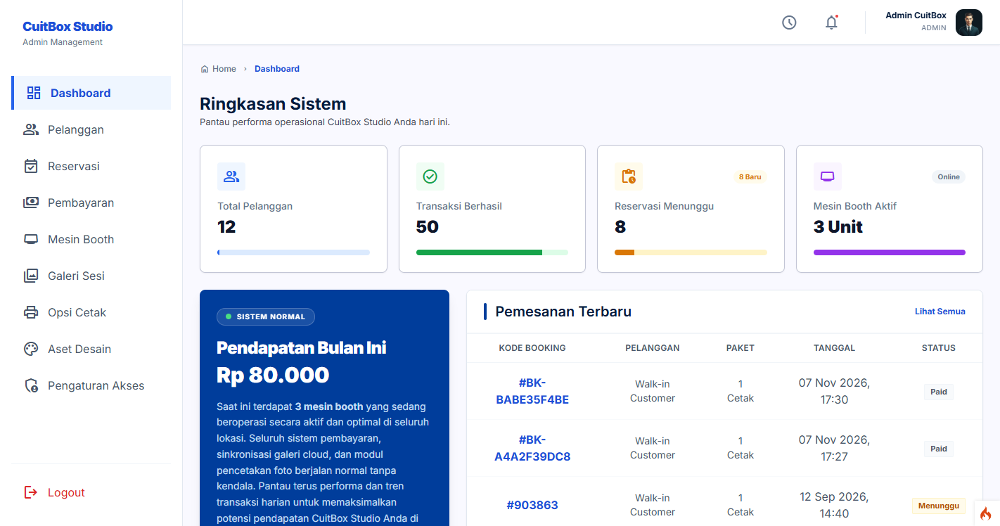 | Ringkasan metrik mesin booth, pendapatan, dan grafik aktivitas. |
| **Manajemen Mesin Booth** | 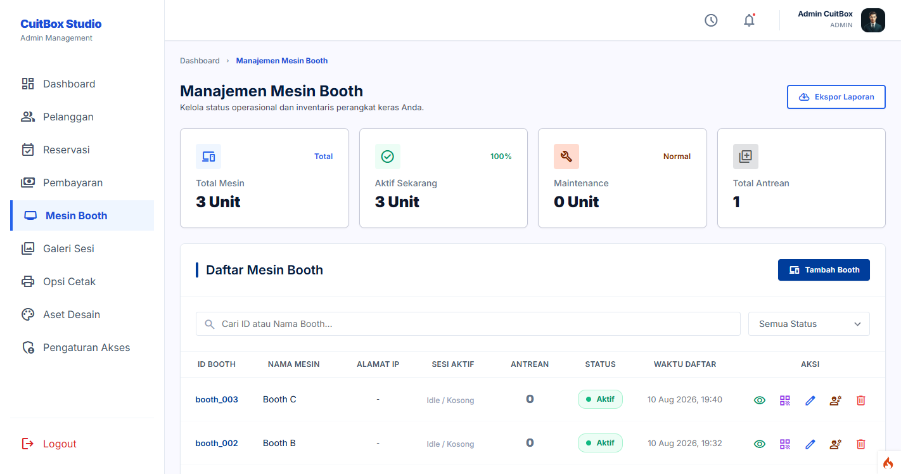 | Daftar unit mesin booth, status antrean, dan kontrol pemeliharaan. |
| **Form Tambah Booth** | 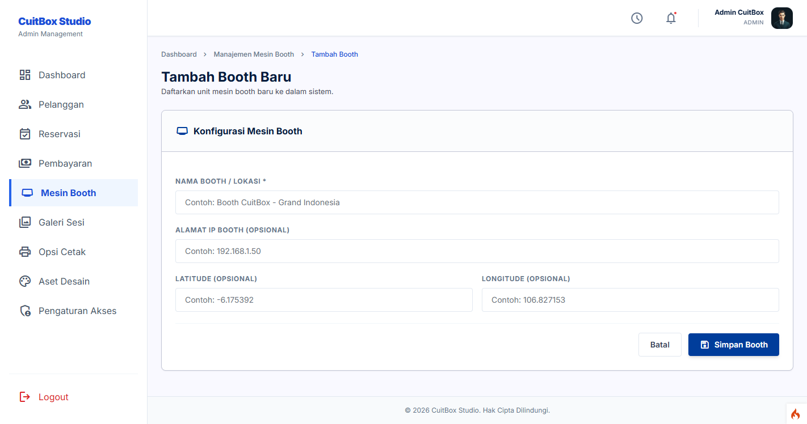 | Formulir pendaftaran unit booth dan IP Address mesin. |
| **Daftar Reservasi** | 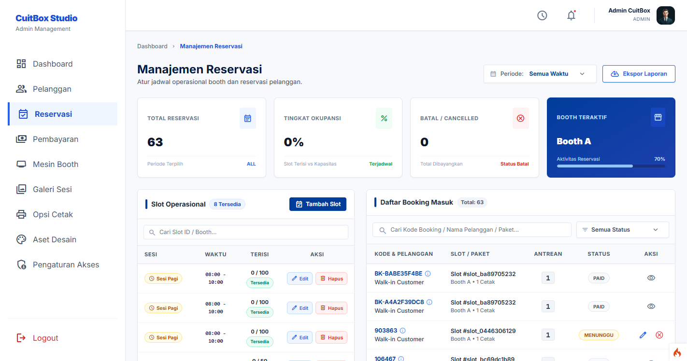 | Tabel pemantauan data booking dan detail customer. |
| **Kalender Slot** | 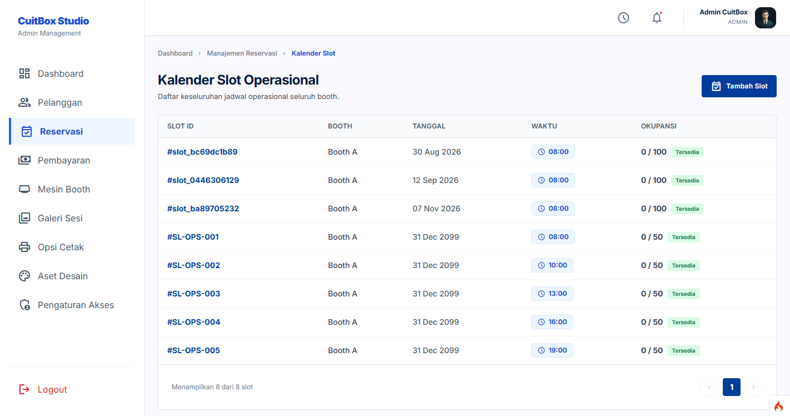 | Visualisasi kalender jadwal jam operasional photobox. |
| **Manajemen Pembayaran** | 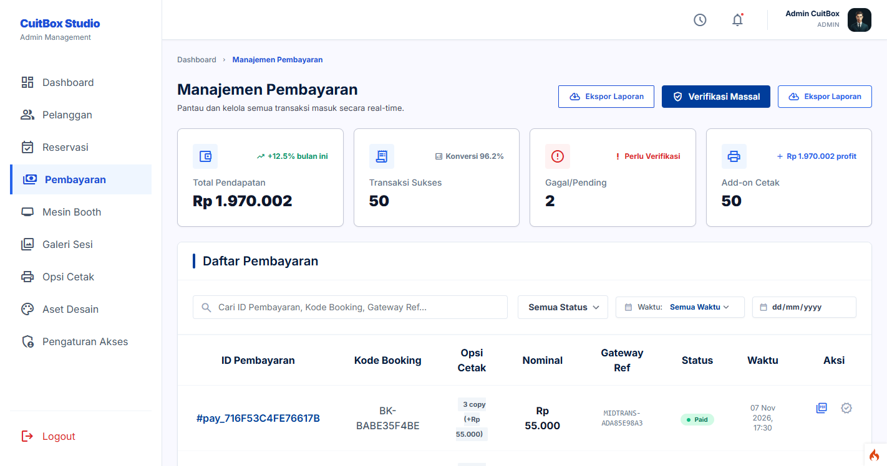 | Rekapitulasi transaksi pembayaran lunas dan tertunda. |
| **Data Pelanggan** | 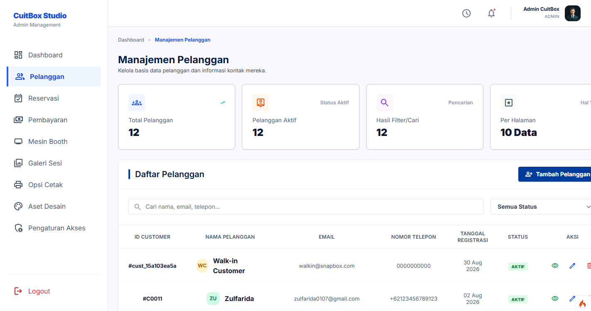 | Direktori akun pelanggan terdaftar dan riwayat sesi foto. |
| **Sesi & Foto** | 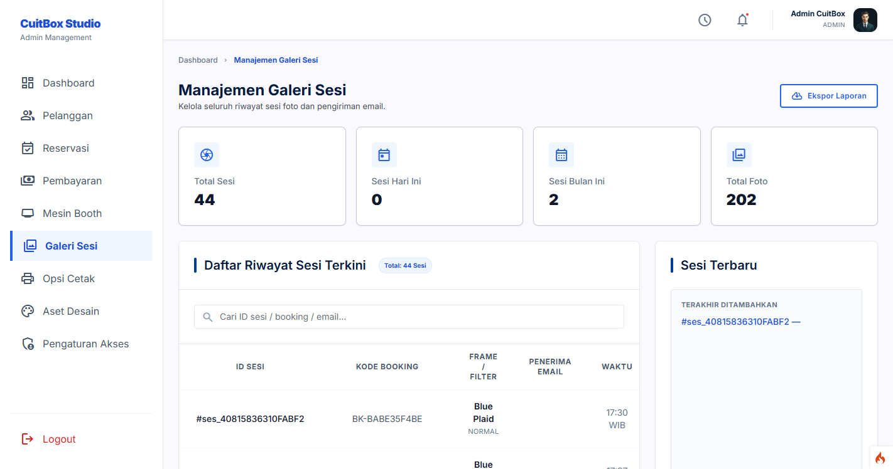 | Pemantauan hasil jepretan kamera dan integrasi drive. |
| **Paket & Opsi Cetak** | 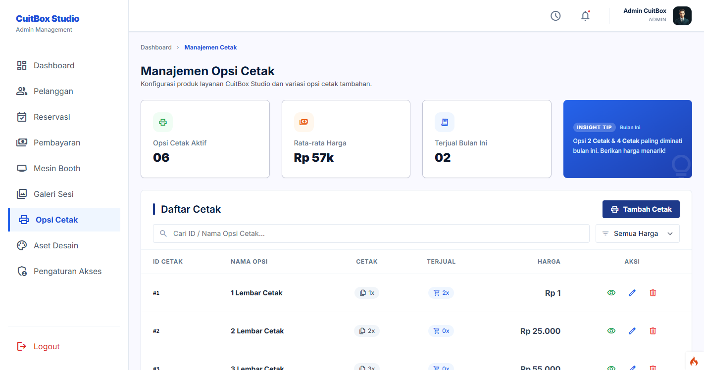 | Konfigurasi harga paket cetak foto dan jumlah lembar. |
| **Frame & Filter** | 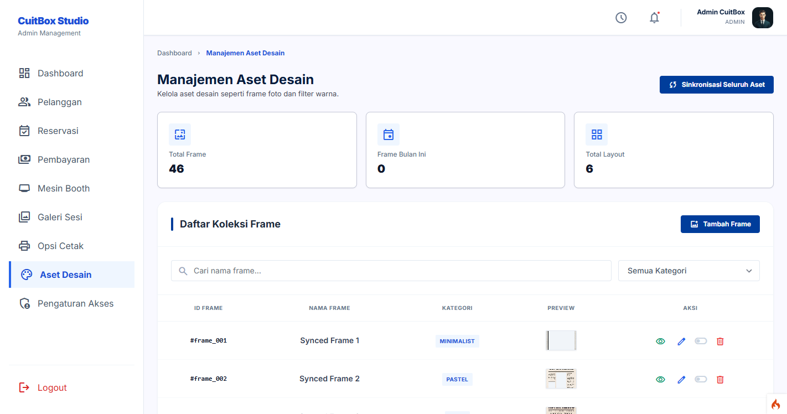 | Manajemen bingkai foto digital (*custom frame layout*). |
| **Pengaturan Akses (RBAC)**| 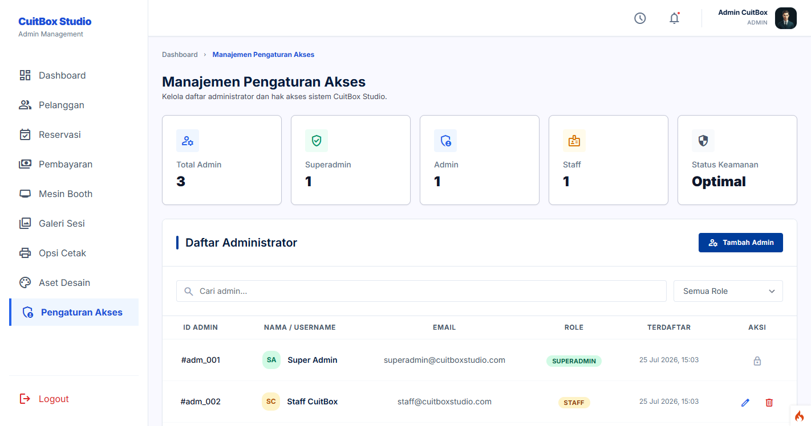 | Manajemen kredensial, role staf, dan audit izin akses. |
| **Form Tambah Akun** | 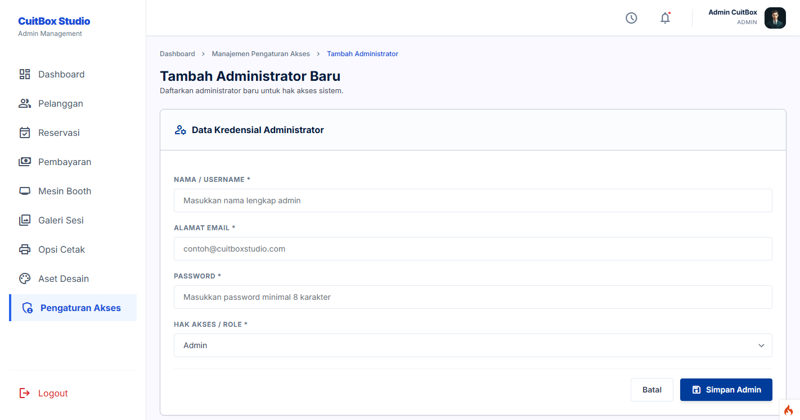 | Formulir pembuatan user admin atau staf operasional baru. |

### 2. Portal Reservasi Pelanggan (`Port 8081`)
| Antarmuka | Pratinjau Tampilan | Deskripsi |
| :--- | :---: | :--- |
| **Landing Page** | 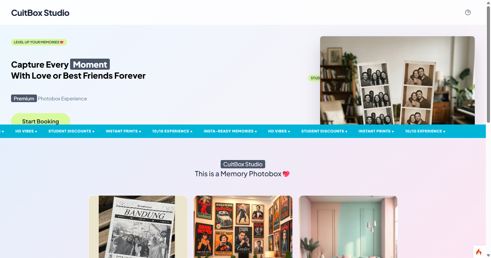 | Halaman beranda interaktif bertema retro-modern. |
| **Kalender Reservasi** | 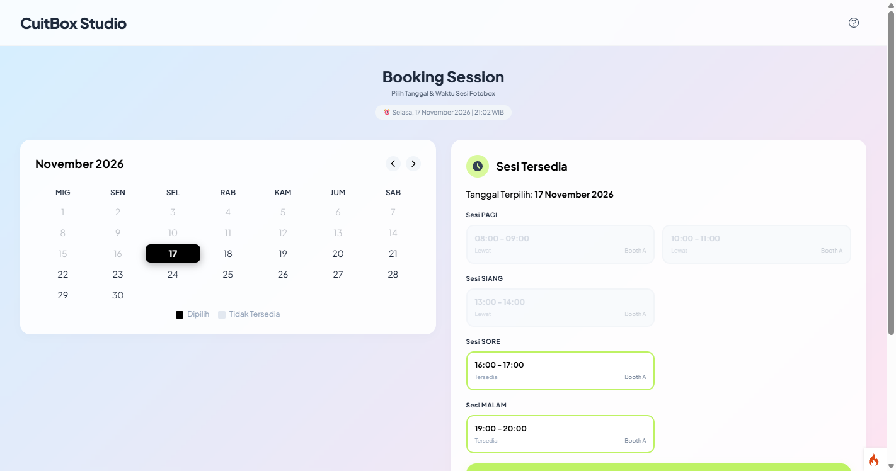 | Pemilihan tanggal sesi foto dan jam yang tersedia. |
| **Pilihan Booth** | 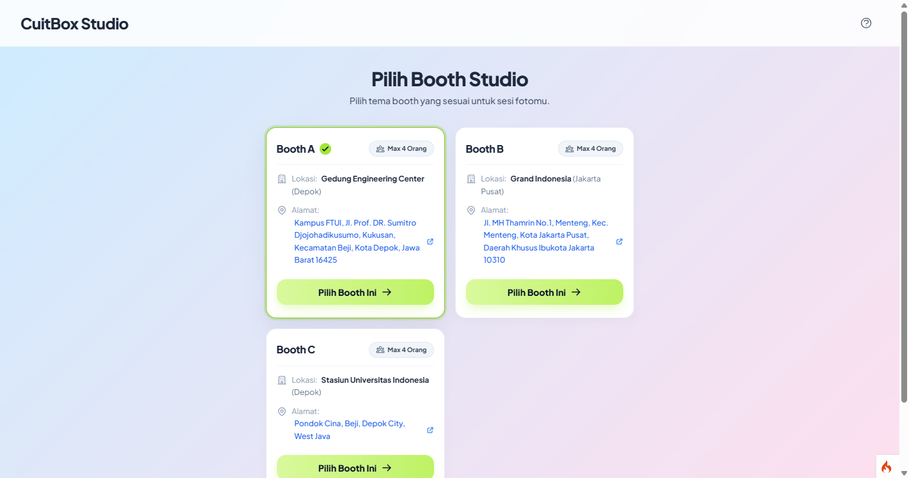 | Antarmuka pemilihan studio photobox terdekat. |
| **Opsi Cetak** | 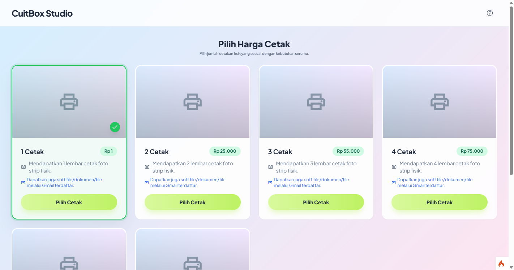 | Katalog pilihan paket lembar cetak foto. |
| **Login Pelanggan** | 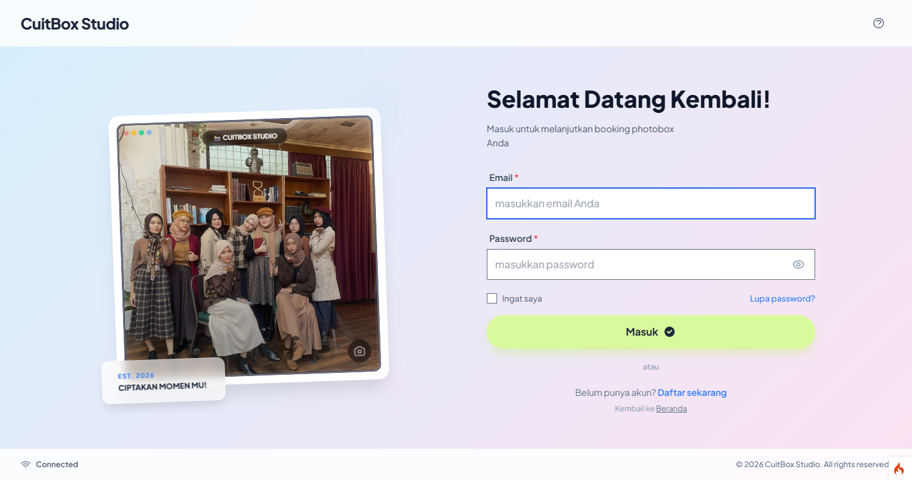 | Autentikasi akun member customer. |
| **Registrasi Pelanggan** | 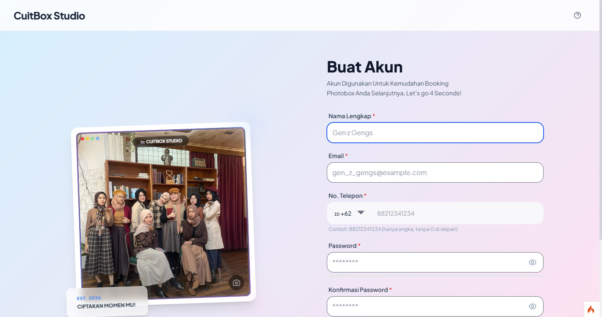 | Formulir pendaftaran akun member baru. |
| **Pusat Bantuan** | 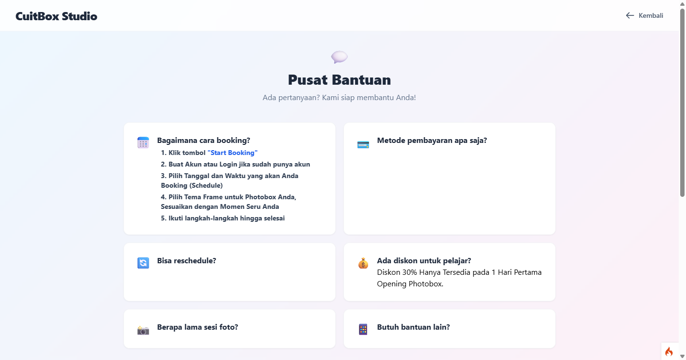 | Halaman panduan pemotretan dan kontak layanan pelanggan. |

---

## 🛠️ Teknologi

| Komponen | Spesifikasi / Library |
| :--- | :--- |
| **Core Framework** | CodeIgniter 4 (PHP 8.2+ / 8.3) dengan arsitektur MVC |
| **Frontend Styling** | Tailwind CSS (CDN/Custom Config), Vanilla CSS, Alpine.js |
| **Iconography & Fonts** | Google Material Symbols & Epilogue Font Family |
| **Database Engine** | MySQL / MariaDB (InnoDb Engine, UTF8mb4) |
| **Cloud Storage** | Google Drive API via Google API Client PHP (OAuth 2.0) |
| **Mailing System** | PHPMailer / CI4 Email Service (SMTP SSL Port 465) |
| **Payment Gateway** | Midtrans Snap API (Sandbox & Production Ready) |
| **Package Manager** | Composer 2.x |
| **Web Server** | Apache (Laragon / XAMPP) / PHP Built-in Spark Server |

---

## 🏗️ Arsitektur Sistem

Aplikasi ini dibangun menggunakan arsitektur **Model-View-Controller (MVC)** yang memisahkan tanggung jawab kode secara terstruktur:

```
Photobox_Website/
├── app/
│   ├── Config/              # Konfigurasi App, Database, Routes, dan Filters
│   ├── Controllers/
│   │   ├── Admin/           # Controller RBAC, Booth, Booking, Payment, & Catalog
│   │   ├── Api/             # RESTful API Endpoint untuk integrasi Kiosk & Hardware
│   │   ├── Customer/        # Controller alur pemotretan & kamera
│   │   └── User_Booking/    # Controller alur registrasi & booking online
│   ├── Database/
│   │   ├── Migrations/      # Skema DDL Database Terversi
│   │   └── Seeds/           # Seeder Data Awal (Akun Default, Frame, Paket)
│   ├── Models/              # Model DML terstruktur untuk setiap entitas database
│   └── Views/               # Template antarmuka tampilan (Admin, Customer, Layouts)
├── Dokumentasi/             # Arsip lengkap tangkapan layar UI aplikasi (20 gambar)
├── public/                  # Web root direktori publik (index.php, CSS, Assets)
├── writable/                # File upload sesi foto, cache, dan log sistem
└── spark                    # CLI runner CodeIgniter 4
```

---

## ⚙️ Instalasi & Setup

### Prasyarat Sistem
- PHP 8.2 atau lebih tinggi dengan ekstensi: `intl`, `mbstring`, `mysqli`, `curl`.
- MySQL / MariaDB Server.
- Composer terpasang di sistem.
- Web server lokal (**Laragon** sangat disarankan).

### Langkah Instalasi
1. **Clone Repositori:**
   ```bash
   git clone https://github.com/khanzaen/Photobox_Website.git
   cd Photobox_Website
   ```

2. **Pasang Dependensi Composer:**
   ```bash
   composer install
   ```

3. **Konfigurasi Environment:**
   Salin file `env` menjadi `.env`:
   ```bash
   cp env .env
   ```
   Buka file `.env` dan sesuaikan parameter berikut:
   ```ini
   CI_ENVIRONMENT = development

   # Database Connection
   database.default.hostname = 127.0.0.1
   database.default.database = photobox
   database.default.username = root
   database.default.password = 
   database.default.port = 3306
   ```

4. **Migrasi & Seeder Database:**
   Jalankan migrasi skema tabel dan data awal:
   ```bash
   php spark migrate
   php spark db:seed AdminSeeder
   php spark db:seed DemoFlowSeeder
   ```

---

## 🖥️ Penggunaan

Aplikasi dirancang untuk berjalan pada dua port berbeda agar memudahkan simulasi multi-perangkat:

### 1. Menjalankan Panel Manajemen Admin
Buka terminal pada direktori proyek, lalu jalankan:
```bash
php spark serve --port 8080
```
- Buka browser pada alamat: **[http://localhost:8080/admin](http://localhost:8080/admin)**
- **Kredensial Default:**
  * **Email:** `admin@cuitboxstudio.com`
  * **Password:** `admin123`
  * **Role:** Administrator / Super Admin

### 2. Menjalankan Portal Reservasi Pelanggan (User Booking)
Buka tab terminal baru pada direktori yang sama, lalu jalankan:
```bash
php spark serve --port 8081
```
- Buka browser pada alamat: **[http://localhost:8081](http://localhost:8081)**

---

## 🔌 API Documentation

Aplikasi menyediakan RESTful API untuk komunikasi dengan mesin hardware Kiosk (*Shutter Camera Controller*):

| Endpoint | Method | Deskripsi |
| :--- | :---: | :--- |
| `/api/booths/{id}/session-check` | `GET` | Memeriksa ketersediaan mesin booth sebelum sesi foto dimulai. |
| `/api/customer/frames` | `GET` | Mengambil daftar frame digital aktif yang dapat dipilih customer. |
| `/api/customer/print-options` | `GET` | Mengambil varian opsi lembar cetak foto. |
| `/api/payment/{orderId}/status` | `GET` | Pengecekan real-time status pembayaran gateway Midtrans. |
| `/api/session/settings` | `GET` | Mengambil konfigurasi durasi timer dan batas jepretan kamera. |

---

## 🧪 Testing

Aplikasi telah melalui pengujian fungsional dan verifikasi integritas kode:
1. **Linter Syntax Check:** Memastikan seluruh berkas Controller, Model, dan View bersih dari galat sintaksis:
   ```bash
   php -l spark
   ```
2. **Validasi Skema SKKNI No. 282 Tahun 2016:**
   - [x] **Unit 01 (UI):** Terverifikasi responsif pada resolusi desktop maupun layar sentuh Kiosk.
   - [x] **Unit 02 (Eksekusi):** Sukses dieksekusi melalui PHP Spark CLI & Apache Laragon (HTTP 200).
   - [x] **Unit 03 (Organisasi):** Kode modular standar PSR-4 dengan dokumentasi PHPDoc lengkap.
   - [x] **Unit 04 (Guidelines):** Sanitasi data input form, proteksi CSRF, dan penanganan exception `try-catch`.
   - [x] **Unit 05 (Terstruktur):** Pemrosesan array multi-dimensi, perulangan tabel data, dan manipulasi berkas foto.
   - [x] **Unit 06 (Reuse):** Pemanfaatan library Tailwind CSS, Google Client, dan ekosistem Composer.

---

## 👥 Tim Pengembang

Proyek ini dikembangkan secara kolaboratif oleh tim mahasiswa **TI-FSD 2 (Full Stack Development) — CCIT FTUI**:

| Nama Pengembang | Peran & Tanggung Jawab Utama | Kontribusi Git |
| :--- | :--- | :---: |
| **Zulfarida**<br>`@zulfarida0107-crypto` | **Lead Backend & Web Developer**<br>• Arsitektur Database & Controller CI4<br>• Modul Role-Based Access Control (RBAC) Admin<br>• Sistem User Booking & Penjadwalan Slot Kalender<br>• Integrasi Google Drive OAuth, SMTP, & API Kiosk | 🥇 **80 Commits** |
| **Khanza Haura**<br>`@khanzaen` | **Project Manager & Fullstack Developer**<br>• Manajemen Repositori & Code Review (PR Approval)<br>• Perancangan UI/UX & Flow Desain Antarmuka<br>• Integrasi Layout & Pengujian Alur Kiosk | 🥈 **78 Commits** |
| **Vany Putri Handayani**<br>`3FSD2 CCIT-FTUI` | **UI/UX & Frontend Developer**<br>• Penataan Komponen Tampilan Antarmuka<br>• Pengujian Fungsionalitas & Dokumentasi | 🥉 **14 Commits** |
| **Aidan-Joe** | **Junior Developer**<br>• Aset Desain Frame Digital & Pengujian Input | **9 Commits** |

---

<div align="center">

© 2026 **CuitBox Studio Team**. Seluruh Hak Cipta Dilindungi.

</div>
